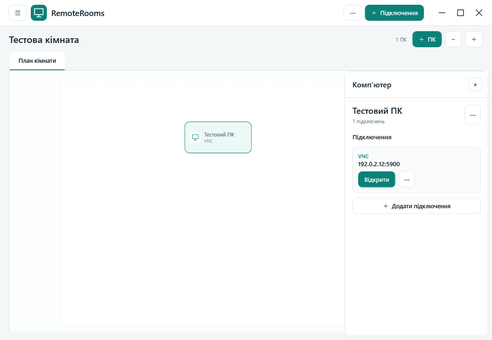

# RemoteRooms

RemoteRooms keeps your remote computers in one place. Arrange them on a simple room map, then open an RDP, VNC, or SSH connection from the computer you need. The app is built for Windows 10/11 x64; its interface is currently in Ukrainian.

**[Download the Windows installer (Setup.exe)](https://github.com/YuraHrunko/RemoteRooms/releases/latest/download/Setup.exe)** · [View releases](https://github.com/YuraHrunko/RemoteRooms/releases)



## What you can do

- Keep rooms, computers, and multiple connections per computer in a local address book.
- Open VNC, RDP, and SSH sessions without juggling separate address lists.
- Start remote desktop sessions in full screen. Use the session bar, `Esc`, or `F11` to return to the app.
- View a VNC desktop as a whole or choose an available screen region when the server exposes a multi-screen layout.
- Move a session window to another local monitor.
- Save connection passwords in Windows Credential Manager, separately from the address book.
- Switch between light and dark themes.

Room maps focus on computers. Existing desk entries remain readable for compatibility, but the current UI does not offer desk editing.

## Install

Download `Setup.exe` from the link above and run it on Windows 10 or 11 x64. The installer includes the self-contained .NET application and installs the WebView2 runtime when the SSH terminal needs it. No separate .NET installation is required.

Windows may show a SmartScreen prompt because this build is not code signed. Check that the publisher and download source are what you expect before running it.

## Build from source

You need the .NET 10 SDK, Inno Setup 7, and the official Microsoft Edge WebView2 Evergreen Standalone Installer for x64. Put the WebView2 installer at `installer/MicrosoftEdgeWebView2RuntimeInstallerX64.exe`. The repository includes the native C++ source and its current compiled `app/RemoteRooms.Core.dll` so the Windows installer can be rebuilt without a separate C++ toolchain.

From the repository root in PowerShell:

```powershell
dotnet publish .\app\RemoteRooms.csproj -c Release -r win-x64 --self-contained true -o .\publish
& 'C:\Program Files (x86)\Inno Setup 7\ISCC.exe' .\setup.iss
```

The Inno Setup script writes `Setup.exe` to the parent directory's `outputs` folder. If you change `native/core.cpp`, rebuild the x64 `RemoteRooms.Core.dll` with a Windows C++17 toolchain before publishing.

For a quick native model check, run `python test_core.py` after the DLL is present. The test uses a temporary address book and checks persistence, undo/redo, deletion, and that passwords are absent from the saved JSON.

## Data and security

The address book stays on this computer. Passwords are stored in Windows Credential Manager and are not included in address book exports. Ordinary VNC can be unencrypted; use it on a trusted network or through a secure tunnel. SSH verifies the server's host key.

## Implementation and notices

The desktop UI uses WPF on .NET 10. The room/address-book model is a native C++ DLL. VNC uses `Lemutec.RemoteViewing.WPF`, SSH uses `SSH.NET` with an xterm.js terminal, and RDP uses the Windows client component. Third-party license notices are in `app/licenses`, `app/assets/xterm-LICENSE`, and `native/vendor/LICENSE.MIT`.

The source is published for inspection and collaboration. No license for the RemoteRooms code has been selected yet; third-party components retain their respective licenses.
